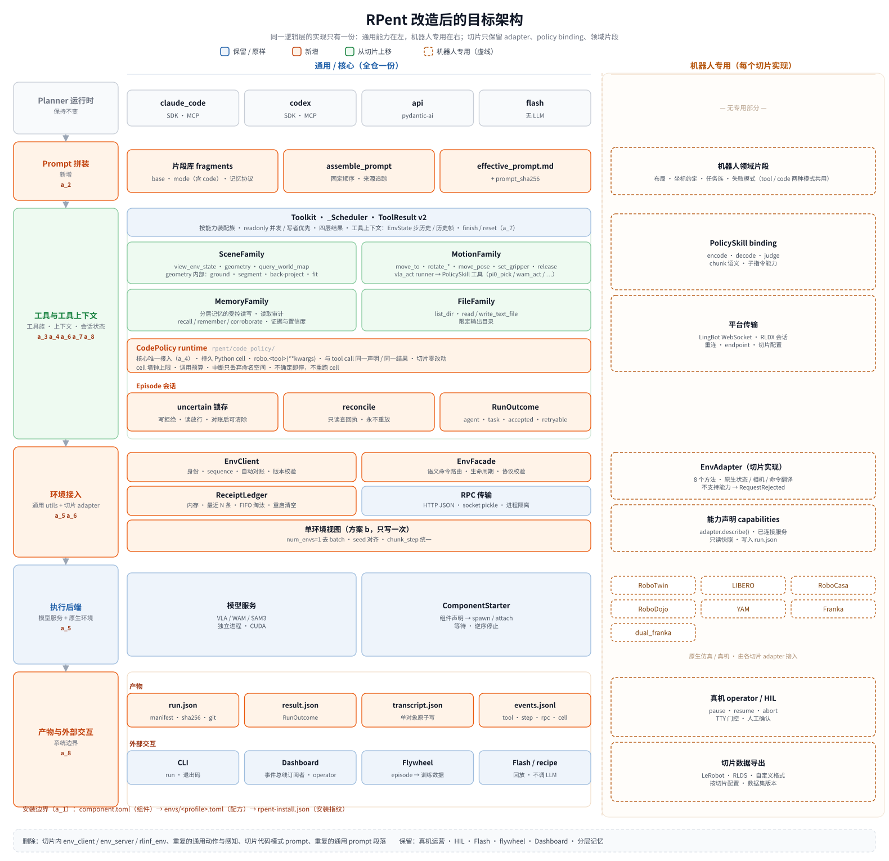
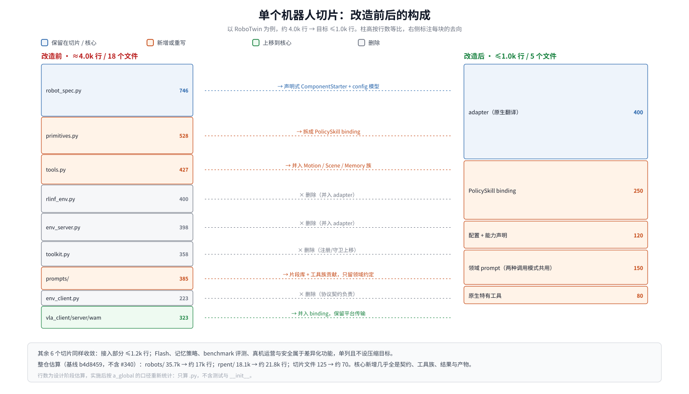

# a_summary 改造后的目标形态
> 状态：草案｜基线 `b4d8459`｜最后更新 2026-11-13

> 汇总目标架构、模块对照、目录设计、代码量与文件量，以及改造本身的成本和取舍。
>
> 前置阅读：[a_global](a_global.md) 第 1、3 节。基线 `b4d8459`，口径见 a_global 5.1。

## 1. 一句话

改造后，RPent 从「每个机器人一条垂直栈」变成「按能力水平分层」：

- **核心全仓一份**：契约、环境 client/facade、工具包与评估、结果契约、prompt 片段、运行产物、验证护栏；
- **切片只保留四样**：adapter、VLA/WAM client binding、配置与能力声明、领域 prompt；
- **差异化功能保持不变**：Flash、分层记忆、真机运营与安全。

## 2. 目标架构



> 图源：[`assets/target_architecture.svg`](assets/target_architecture.svg)。左侧是核心（全仓一份），右侧虚线框是切片实现；每一层标注了负责的主题文档。

| 层 | 核心（全仓一份） | 切片 | 文档 |
|---|---|---|---|
| Planner 运行时 | claude_code / codex / api / flash（不变） | — | — |
| 调用模式 | tool call，以及代码策略 `robo.<tool>()`（同一份声明，核心唯一接入） | — | a_4 |
| 安装与环境 | 组件清单、`envs/` 具名配方、`rpent-env`、安装指纹；根 `pyproject.toml` 只保留核心依赖 | 每个组件目录的 `component.toml`、组件级 override | a_1 |
| Prompt 拼装 | 片段库、`assemble_prompt`（复用 `format_prompt`）、`effective_prompt.md` + sha256 | 领域片段（两种调用模式共用） | a_2 |
| 工具与工具上下文 | Toolkit（readonly 并发、写者优先）、四层 `ToolResult`；`SceneTools` / `MotionTools`（+`vla_act`）/ `MemoryTools` / `CommonTools` 四个装配类；`toolkits/<name>/` 工具包：实现、观测契约与独立评估；工具上下文：`EnvState` 的步历史 / 历史帧、运行模式与预算；Episode 会话：不确定态锁存、自动对账、`RunFinalizationContext`、finish 策略 | VLA/WAM client binding、平台传输、原生特有工具、判据阈值配置 | a_3、a_6、a_7、a_8 |
| 环境接入 | `BaseEnvClient` / `BaseEnvFacade` / `ReceiptLedger` / RPC / 单环境视图 | adapter、能力声明 | a_5、a_6 |
| 执行后端 | 模型服务（VLA / WAM / SAM3）、`runtime.py` 的 `try_spawn_server` / `try_wait_server` / `stop_owned_daemons` | 组件声明、原生仿真 / 真机 | a_5 |
| 产物与外部交互 | `run.json` / `result.json` / `transcript.json` / `events.jsonl`；CLI、Dashboard（事件订阅者）、Flywheel | 真机 operator / HIL、Flash、数据导出 | a_8 |
| 验证 | 契约测试、故障注入、parity、`check_layout` | 切片冒烟 | a_9 |

工具上下文只包含工具读取所需的历史与运行参数；同一层里的 Episode 会话状态机（`uncertain` 锁存、自动对账、`RunFinalizationContext`）不向工具暴露。

## 3. 模块对照

| 维度 | 改造前 | 改造后 | 文档 |
|---|---|---|---|
| 环境接入 | 每个切片写 3 层：rlinf_env / env_server / env_client | 核心提供 1 份 `BaseEnvClient` + `BaseEnvFacade`，切片写 1 个 adapter | a_5 |
| 安装 | 单个 pyproject、14 个 extra、7 个继承、15 对手写冲突 | 组件清单 + 具名配方 + 安装指纹 | a_1 |
| 契约形状 | gym 形状，传原生 action 向量 | 语义命令：pose / joints / native chunk | a_5 |
| 观测 | 原生 obs 透传 | `CameraFrame` / `ArmState` 归一化，grasp site 统一 | a_5 |
| 进程拉起 | 每个 `robot_spec` 286–746 行 | 组件声明 + `runtime.py` 的三个函数 | a_5 |
| 通用动作与感知 | 每种 3–7 份 | 1 份（工具包，各自带评估） | a_3 |
| 感知工具入口 | `segment`、`back_project`、`sample_world_xyz` 分开暴露 | 合并为 `geometry`，原语留在包内 | a_3 |
| 工具改动的证据 | 只能看 episode 是否成功 | 同一冻结语料上的 coverage 与误差前后对比 | a_3、a_9 |
| 原生技能 | 与通用动作混写，阈值是工具参数 | VLA/WAM client binding，判据阈值放在配置 | a_3、a_7 |
| 工具结果 | 单一 `data` 字典 | 四层：调用、执行、确定性、领域 | a_3 |
| 记忆访问 | 通用文件工具，可被 SDK 内置工具绕过 | Memory 族三工具，权限对所有写入路径生效 | a_3 |
| 物理写可靠性 | 传输失败等同执行失败，可能执行两次 | 回执、锁存、自动只读对账，at-most-once | a_6 |
| 成功口径 | 三处来源混用，评测模式下真值对模型可见 | `RunFinalizationContext` 分层，真值隔离，退出码 0 / 1 / 75 | a_7 |
| Prompt | 每个切片一棵大树，合计约 3.0k 行 | 片段 + 工具族贡献 + 领域片段，约 1.2k 行 | a_2 |
| 运行产物 | transcript 追加写，没有 manifest | manifest、单对象 transcript、单一事件总线 | a_8 |
| 验证 | 97 个按模块组织的测试 | 加上契约、故障注入、parity、`check_layout` | a_9 |
| 代码策略模式 | 切片各写一份 prompt（共 794 行），无记忆，教模型读真值 | 核心唯一接入，切片零改动，有记忆，真值隔离 | a_4 |
| 迁移开关 | — | 只有 `env_contract` 一个，迁移完成后删除 | a_global |

## 4. 目录设计

```
rpent/
  env/                       # 新增（a_5、a_6）
    contracts.py             # EnvSnapshot / ArmState / CameraFrame
    receipts.py              # ReceiptLedger（内存，挂在 RpcFacade 上）
  robots/components/
    env_client_base.py       # 现有：身份、自动对账、版本校验
    env_facade_base.py       # 现有：语义命令路由、生命周期
    config.py                # 配置模型（a_5）
  utils/rpc/
    rpc_client.py rpc_facade.py  # 保留；增加 request_id / sequence / ReceiptLedger
  tools/
    base.py                  # 保留：四层 ToolResult（a_3）
    common.py                # 保留：文件工具 CommonTools
    toolkit.py               # 保留；用 add_tools 装配，finish 策略
    scene_tools.py motion_tools.py memory_tools.py  # 新增：族装配，实现放 toolkits/（a_3）
  code_policy/               # PR #340：runtime / toolkit / worker（a_4 只改接入点）
  prompt/
    assembly.py              # 新增：assemble_prompt，复用 format_prompt（a_2）
    fragments/*.md           # 新增：base / mode_* / memory_protocol（共 6 份）
    code_policy.py           # PR #340，作为 mode 层
  evaluation/
    result.py                # 扩展 RunFinalizationContext、finish 策略（a_7）
  artifacts/                 # 新增（a_8）
    manifest.py  events.py
  robots/
    runtime.py               # 现有：try_spawn_server / try_wait_server / stop_owned_daemons（a_5）

toolkits/                    # 新增（a_3）：能力实现 + 独立评估
  geometry/
    component.toml           # 依赖、探针与评估依赖（a_1）
    tool.py                  # planner 唯一入口：@tool 声明
    core.py observation.py prompts.py
    evaluation/              # 固定语料、独立参考、冻结重放、report.md

robots/<name>/               # 每个切片
  component.toml             # 直接依赖、探针、Python/平台与冲突（a_1）
  __init__.py                # get_robot_spec / get_toolkit（入口，保留）
  rlinf_env.py / rpent_env.py # 现有 env 类，只做原生翻译
  config.py                  # 配置模型、能力补充、组件声明、success_criteria、启用的工具类
  skills/<skill>.py          # VLA/WAM client binding（含原 vla_client / server 的平台传输）
  prompts/domain.py          # 领域片段（两种调用模式共用）
  native_tools.py            # 可选：真正特有的工具
  flash/  memory.py  ...     # 差异化功能，按需保留

envs/                        # 新增（a_1）：具名环境配方
  minimal.toml  libero-pro.toml  robotwin.toml  ...
  locks/                     # 每个配方的依赖锁

tests/
  unit_tests/contracts/      # 新增：各主题的契约测试
  unit_tests/fault_injection/# 新增：FakeEnvServer / FakeRpcTransport
  parity/                    # 新增：scripted planner + ParityRecord
scripts/check_layout.py      # 新增（a_9）
```

**新机器人的最小接入清单**：`component.toml`、`rlinf_env.py` / `rpent_env.py`、`config.py`、`skills/`、`prompts/domain.py`，共 5 类文件、约 1k 行。代码策略模式、产物、结果口径、prompt 通用段落、依赖组合都不需要写。

## 5. 切片改造前后



> 图源：[`assets/slice_before_after.svg`](assets/slice_before_after.svg)，以 RoboTwin 为例。

| 切片 | 基线 | 接入部分目标 | 保留的差异化功能 | 目标合计 |
|---|---|---|---|---|
| robotwin | 4.0k | ≤1.0k | — | 约 1.0k |
| robodojo | 3.5k | ≤1.0k | Flash 0.5k | 约 1.5k |
| libero | 6.4k | ≤1.2k | Flash 1.3k、记忆 hook 0.2k | 约 2.7k |
| robocasa | 4.5k | ≤1.2k | benchmark 评测 0.4k、记忆 hook 0.2k | 约 1.8k |
| franka | 3.8k | ≤1.0k | Flash 0.9k、标定相关感知 0.4k | 约 2.3k |
| dual_franka | 6.1k | ≤1.2k | HIL / verdict 1.5k、标定相关感知 0.5k | 约 3.2k |
| yam | 7.4k | ≤1.0k | 硬件租约、伺服、几何、恢复、operator 3.5k | 约 4.5k |
| **合计** | **35.7k** | **约 7.6k** | **约 9.4k** | **约 17k** |

仿真切片收敛得最彻底。真机切片的运营与安全逻辑本身就和具体机器人强相关，只去掉其中的重复工具和样板代码。三套 Flash 实现的合并不在本轮范围内。

## 6. 代码量与文件量估算

### 6.1 核心新增

| 模块 | 文件 | 行数 | 文档 |
|---|---|---|---|
| env 契约与接入（新增 `contracts.py` / `receipts.py`，修改 `env_client_base.py` / `env_facade_base.py` / `rpc_client.py` / `rpc_facade.py` / `config.py`） | 7 | 1.1–1.4k | a_3、a_5、a_6 |
| `rpent/tools/base.py` + `scene_tools.py` / `motion_tools.py` / `memory_tools.py` | 5 | 1.3–1.7k（大部分从切片上移） | a_3 |
| `rpent/robots/components/config.py`、`rpent/robots/runtime.py` | 2 | 0.3–0.4k | a_5 |
| `rpent/evaluation/result.py` | 1 | 0.15–0.2k | a_7 |
| `rpent/prompt/assembly.py`（另有 6 份 `.md` 片段，约 0.3k 行） | 1 | 约 0.1k | a_2 |
| `rpent/artifacts/` | 2 | 0.25–0.3k | a_8 |
| 现有模块的修改（toolkit、cli、planner、code_policy 接入点）与删除（切片里的 env_client / env_server 拷贝等） | — | 约 +0.3k / −0.3k | 各篇 |
| **合计** | **约 18** | **约 +3.7k** | |

`toolkits/` 是新增的顶层，不并入上表的 `rpent/` 统计。以 #341 的 `toolkits/geometry/` 为参考：约 5.5k 行 / 15 个文件（实现约 2.8k、评估约 2.6k）。它不是从切片搬来的代码，而是新增的感知能力；其它工具包按需迁移，不要求一次建齐。

a_1 的 `rpent-env` 与清单检查另计约 0.4–0.6k 行 / 2 个文件，也不并入上表；`component.toml` 与 `envs/` 是 TOML，不计入 Python 行数。

### 6.2 全仓净变化

| | 基线 | 目标 | 变化 |
|---|---|---|---|
| `rpent/` | 18.1k 行 / 83 个文件 | 约 21.8k 行 / 约 101 个文件 | +3.7k / +18 |
| `robots/` | 35.7k 行 / 125 个文件 | 约 17k 行 / 约 70 个文件 | −18.7k / −55 |
| **合计** | **53.8k 行** | **约 38.8k 行** | **−15k（−28%）** |
| `robots/` 占比 | 66% | 约 44% | |
| 测试文件 | 97 | 约 125 | +28（契约约 14、故障注入约 6、parity 约 3、工具族约 5） |
| 新增测试代码 | — | 1.5–2.5k 行 | |

**PR #340 单独计算**：它给核心新增约 0.84k 行、5 个文件，给切片新增 794 行 prompt。a_4 完成后，切片里的这 794 行降为 0，核心部分保留。

**工具包单独计算**：`toolkits/` 不在上表内。参考实现 #341 的 `toolkits/geometry/` 约 5.5k 行 / 15 个文件，其中评估约占一半；这部分换来的是可重放的感知质量基线，不是重复代码的减少。

### 6.3 阶段性变化

| 时点 | `rpent/` | `robots/` | 合计 |
|---|---|---|---|
| 基线 | 18.1k | 35.7k | 53.8k |
| 第一批完成（契约 + 回执，RoboTwin 试点） | 约 19.8k | 约 33.0k | 约 52.8k |
| 第二批完成（工具族 + 真值，仿真切片迁完） | 约 21.2k | 约 23k | 约 44.2k |
| 全部完成（含真机切片、prompt、产物） | 约 21.8k | 约 17k | 约 38.8k |

以上都是设计阶段的估算。每批完成后，按 a_global 5.1 的口径重新统计并校准。

## 7. 改造成本与批次

| 批次 | 内容 | 规模（估） | 完成标志 |
|---|---|---|---|
| 1 契约、安装与可靠性 | a_1 P1–P2、a_5 P0–P2、a_6、a_9 基础设施 | 约 5–6 个 PR | 3 个试点配方可检查、可安装；RoboTwin 只靠 adapter 跑通；故障注入下重复执行次数为 0 |
| 2 工具与口径 | a_3、a_7，以及仿真切片迁移 | 约 8–10 个 PR | 切片里的通用动作为 0；感知工具只有一个入口；80-case 工具评估可重放 |
| 3 提示词、代码模式与产物 | a_2、a_4、a_8、a_5 P3 | 约 6–8 个 PR | prompt 行数达标；代码模式下切片零改动；每次运行都有 manifest |
| 4 真机切片 | yam、franka、dual_franka 迁移 | 每个切片约 2 个 PR | 回执、锁存和门控行为与迁移前一致 |

**代价**：

- 核心增加约 3.7k 行、18 个文件；
- 工具包和评估语料需要持续维护，语料变更要走版本；
- 迁移期新旧路径并存；
- 新贡献者需要先读 a_global 第 3、4 节，以及本文第 4 节的接入清单；
- 切片能自由发挥的空间变小，新能力要么进工具包，要么通过 R7 审查。

## 8. 明确舍弃的设计

| 舍弃项 | 原因 |
|---|---|
| 按资源调度与后台作业（job 工具） | env 是单进程，写调用本来就串行；真正的并发点已经是独立进程 |
| 跨 planner 的 `ContextPolicy` 抽象 | 三个 planner 里有两个由 SDK 管理上下文，只剩一个消费者 |
| telemetry 框架（span / metric） | `elapsed_s` 加事件时间戳已经够用 |
| 账本落盘 | 违背「重启后不得重放」的原则 |
| 多个迁移开关和开关组合矩阵 | 只保留一个 `env_contract`，其余改动原地替换 |
| 语义地图、向量检索、agent 可调用的 `forget` | 目前没有使用方；遗忘交给合并规则和人工审阅 |
| 暴露给模型的 reconcile 工具 | 由框架自动对账即可，不增加模型需要理解的概念 |
| `rpent reproduce` 命令 | manifest 已经足以人工复现，有真实需求时再加 |
| provider 继承体系、模板 DSL、FastAPI 服务化 | Protocol 加注册表、Python 树、现有 RPC 已经够用 |
| 统一的工具 benchmark 平台 | 每个工具包的 `evaluation/` 目录足够；只在需要比较时共享语料格式 |
| 把评估语料和原始数据放进源码树 | 仓库只保留固定清单与报告；RGB-D、mask、预测留在外部运行目录 |
| 按 extra 拆成多个 PyPI 发行包 | 冲突在环境解析，不在发行元数据；多包仍要逐环境解析，还会引入版本漂移 |
| 运行时自动安装依赖 | 不可复现，且会在 GPU 机器上产生未记录的环境变化 |

## 9. 怎样判定改造成功

不看总行数，看以下九条：

1. 新增一个仿真机器人，只改 `robots/<name>/` 一个目录，接入部分不超过 1.2k 行；
2. 切片里找不到 `env_client.py`，也找不到 `move_to`、`set_gripper`、`view_env_state` 的本地实现；
3. 一次超时不会导致同一个动作执行两次，运行中能通过对账恢复；
4. 评测模式下，无论 tool call 还是代码模式，模型都看不到真值字段；
5. 只凭产物目录，就能回答「跑了什么、模型看到了什么、结果是否可以接受」；
6. 任意已注册的工具不需要额外包装，就能以 `robo.<tool>(**kwargs)` 调用，返回与 tool call 一致；
7. 用 SDK 内置工具写记忆目录会被拒绝，佐证会参与记忆合并；
8. 改一个感知工具的参数或算法，不改任何切片，就能在同一冻结语料上看到 coverage 与误差的前后对比；
9. 在新机器上只凭一个具名配方装出环境，`rpent-env doctor` 通过；缺组件时错误信息直接给出安装命令，`run.json` 能追到安装指纹。
