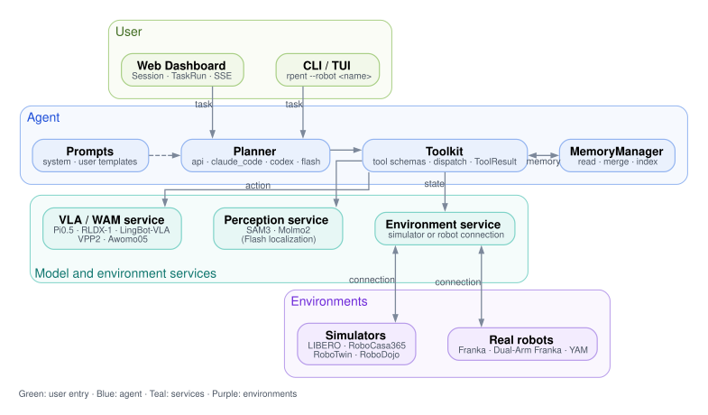
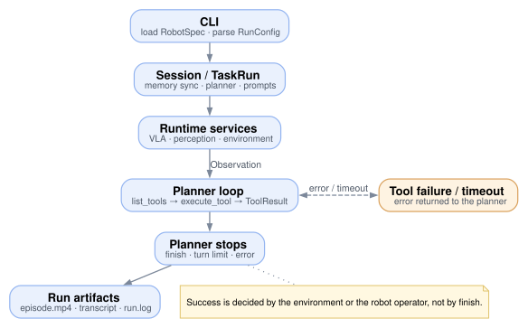

.. _system-internals:

Architecture and Execution
==========================

RPent separates task planning, tool execution, and environment operation. The planner chooses tools, the toolkit dispatches them to perception or action components, and the environment returns updated state. Environments connect to the shared runner through ``RobotSpec``.

.. page-head::
   :for: Engineers who need to know which component executes a call and where to change it
   :outcome: You can trace one run through the CLI, planner, toolkit, and services, and choose the right extension page
   :read-when: You are reviewing the execution path, planning an integration, or locating the code that owns a behavior
   :skip-when: You only need to run a task; start with :doc:`../get_started/quickstart` or the page for your platform

**Page map:** one run end to end → component responsibilities → repository layout → command entry points → environment discovery → Dashboard sessions → extension guides.

   Read from top to bottom. A user entry point sends a task to the planner;
   the planner drives the toolkit, which calls services; services hold the
   simulator or robot connection. Solid arrows are calls, dashed arrows are
   inputs, and double arrows are shared connections.

Task Execution
--------------

The runner prepares the task and its services before handing control to the
planner. During execution, each tool result supplies the observations used for
the next decision. The sequence below follows one run from CLI setup to cleanup.

1. The CLI reads shared arguments, loads the environment selected by ``--robot``, and registers and validates its arguments.
2. ``parse_config`` creates a ``RunConfig`` with the task, output directory, and prompt variables.
3. The runner synchronizes or uses local memory according to the profile, constructs the planner, and renders prompts.
4. ``init_runtime`` starts or connects to services and returns runtime inputs and owned processes; ``get_toolkit`` creates tools and their memory manager.
5. The planner obtains schemas through ``list_tools``, dispatches calls through ``execute_tool``, and consumes text and image results.
6. Action tools call a VLA or scripted motion. The environment records updated state and observations for the next planning turn.
7. ``finish``, a run limit, or an error ends planning. The runner saves the transcript, finalizes recordings, and cleans up. Environments that publish evaluation artifacts use their finalization hook.

   Read from top to bottom. The CLI builds a session, services start, the
   planner loops until it stops, and artifacts are saved. A failing or
   timed-out tool returns an error result to the planner, which decides
   whether to retry. Success is decided by the environment or the robot
   operator.

``finish`` marks the end of planning; success comes from the environment or a real-robot operator. See each environment guide for its criterion. The main entry point is ``rpent/cli/main.py``.

Component Responsibilities
--------------------------

The toolkit connects planning to environment-specific actions. Model services
and the environment retain their own state, while the runner manages their
lifetime. This division lets a planner use the same tool interface across
different robots.

.. list-table::
   :header-rows: 1
   :widths: 25 75

   * - Component
     - Responsibility
   * - Planner
     - Select tools, manage model interaction, and return ``PlannerResult``. The ``api`` backend uses the native Pydantic AI loop and Harness sliding-window history trimming; ``claude_code`` and ``codex`` use their respective SDKs. LIBERO Flash executes stored plans.
   * - Toolkit
     - Define schemas, dispatch calls, record state, and expose results as ``ToolResult`` for the planner.
   * - Environment service
     - Own the simulator or robot connection, execute actions, and expose native state and success information.
   * - VLA / perception services
     - Load models for action prediction, segmentation, and other capabilities selected by the environment.
   * - MemoryManager
     - Control memory reads and exploration writes, and manage merging and indexing.

In LIBERO, the environment, Pi0.5, and SAM3 run in separate service processes. Action tools advance the environment; read tools such as ``view_env_state`` inspect recorded state. Remote procedure calls (RPC) support HTTP and socket transports. See :doc:`interfaces` for contracts and :doc:`../guides/advanced_deployment` for standalone deployment.

Repository Layout
-----------------

Shared execution and interfaces live under ``rpent/``. Each package under
``robots/`` supplies the environment-specific implementation described above.

.. code-block:: text

   rpent/
     cli/          # CLI, Dashboard launcher, memory commands
     planner/      # Model backends and Planner base class
     prompt/       # Shared prompt construction
     session/      # Session and task lifecycle
     dashboard/    # Web UI and event delivery
     robots/       # Discovery, descriptors, runtime components
     tools/        # Toolkit and shared tool behavior
     memory/       # Memory permissions, merge, and indexing
     evaluation/   # Evaluation result support
   robots/
     libero/
     robocasa/
     robotwin/
     robodojo/
     franka/
     dual_franka/
     yam/
   docs/
     source-en/    # English pages
     source-zh/    # Chinese pages at matching paths
     _diagrams/    # Diagram sources; make diagrams regenerates the SVGs
     _ext/         # Sphinx extensions, including the leaderboard renderer
     _static/      # Images, styles, and leaderboard data

Command Entry Points
--------------------

``pyproject.toml`` declares four RPent commands. Simulator and asset commands
are installed by the dependency packages that each extra pulls in; they are not
defined in this repository.

.. list-table::
   :header-rows: 1
   :widths: 34 34 32

   * - Command
     - Defined by
     - Purpose
   * - ``rpent``
     - ``pyproject.toml`` (``rpent.cli.main:main``)
     - Run a task or start the Dashboard.
   * - ``rpent-memory``
     - ``pyproject.toml`` (``rpent.cli.memory:main``)
     - Validate, index, and merge a memory directory.
   * - ``rpent-check-llm``
     - ``pyproject.toml`` (``rpent.cli.check_llm:main``)
     - Check planner credentials and connectivity.
   * - ``rpent-flywheel``
     - ``pyproject.toml`` (``rpent.flywheel.cli:main``)
     - Export recorded trajectories for VLA training.
   * - ``libero-download-assets``, ``liberopro-download-assets``,
       ``liberoplus-download-assets``
     - ``rpent-libero``, ``rpent-liberopro``, ``rlinf-liberoplus``
     - Download scene assets for the selected LIBERO variant.
   * - ``robocasa-download-assets``
     - ``rpent-robocasa365``
     - Download kitchen assets.
   * - ``robotwin-download-assets``
     - ``rlinf-robotwin-runtime``
     - Download RoboTwin assets.

Environment Discovery
---------------------

``enumerate_robots`` in ``rpent/robots/base.py`` discovers packages under ``robots/``. The CLI uses that result for ``--robot`` choices. Selecting ``myrobot`` lazily imports ``robots.myrobot``. Its package entry exposes two factories:

.. code-block:: python

   def get_robot_spec() -> RobotSpec: ...

   def get_toolkit(*, runtime_kwargs, dashboard_events, config): ...

``RobotSpec`` declares prompts, CLI arguments, run configuration, service startup, and optional Dashboard and exploration capabilities. ``get_toolkit`` receives the run configuration and constructs tools; some environments accept additional mode or state-directory arguments. See :doc:`interfaces` for contracts and :doc:`add_robot` for integration steps.

Dashboard Sessions
------------------

The Dashboard uses a long-lived Session to manage services and creates a TaskRun for each task. ``DashboardSpec`` defines the task command and its fields, runtime components marked ``shared`` or ``unique``, and primitive controls.

A LIBERO Session reuses Pi0.5 and SAM3, while each sequential TaskRun owns its environment, toolkit, and planner conversation. The owning session or task cleans up its components.

The browser receives session updates through server-sent events (SSE) at
``/api/session/stream`` and fetches transcript events as they become available.
It uses those updates to refresh the conversation, camera views, and action
timeline. Direct primitive controls use the schemas declared by the robot;
the backend validates their arguments before dispatching the tool call. See
:doc:`../guides/dashboard` for usage and :doc:`add_robot` for Dashboard integration.

Extension Guides
----------------

Choose the guide for the component you want to extend.

.. list-table::
   :header-rows: 1

   * - Goal
     - Guide
   * - Connect an environment, robot, or Dashboard control.
     - :doc:`add_robot`
   * - Expose an action or perception capability as a tool.
     - :doc:`add_primitive`
   * - Add a planning backend.
     - :doc:`add_planner`
   * - Understand memory access and persistence.
     - :doc:`memory`
