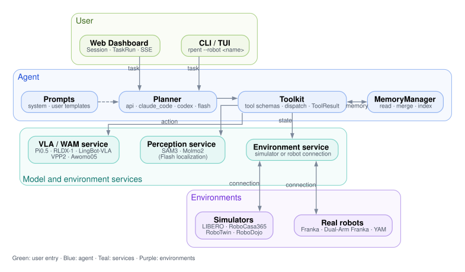

Introduction to RPent
=====================

This page introduces the framework, its benchmark coverage, and the supported
platforms. Installation and a first run are in :doc:`quickstart`.

.. page-head::
   :for: Readers deciding whether RPent fits their work and which platform to start on
   :outcome: You can describe the agent loop, the benchmark coverage, and the page to read next
   :read-when: You are new to RPent or choosing between a simulator and a real robot
   :skip-when: You only need installation steps; go to :doc:`quickstart`

**Page map:** the framework and its design principles → where benchmark results live → which platform group to start from → the planners.

**RPent (Recursive Physical Agent)** is an open framework for building embodied
agents that accumulate experience and improve their behavior through interaction with the physical world.
Rather than prescribing a single foundation model, RPent puts perception, reasoning,
memory, execution, and self-evolution in one agent loop behind shared interfaces.
Models, planners, and robot services can be replaced or combined without rewriting
the workflow. Through continuous interaction, reflection, and adaptation, an RPent
agent acquires new capabilities and evolves beyond its initial design.

The name Pent is inspired by the Pentagram, whose five points symbolize the integration
of multimodal intelligence into a unified embodied agent. At its center, the infinity
symbol (∞) represents the endless recursive cycle of perception, reasoning,
execution, and self-evolution, through which intelligence continuously expands into the physical world.

RPent is built upon three core design principles: **service-oriented, standardized, and composable**.
Capabilities deploy as reusable services, connect through shared interfaces, and compose into different physical agents.

Leaderboard
-----------

RPent reports success rates on LIBERO, LIBERO-PRO, RoboCasa365 Target50, and
RoboTwin C2R. The :doc:`leaderboard <../leaderboard/index>` holds the charts,
the per-benchmark tables, the model configurations behind each row, and the
sources. :doc:`Time & token costs <../leaderboard/time-token-costs>` reports the
runtime and token measurements for the same configurations.

Choose a Platform
-----------------

Platforms fall into two groups. Each index page compares the options and links
to the page that installs and runs one of them:

- :doc:`Simulators <../simulators/index>`: LIBERO, RoboCasa365, RoboTwin, and
  RoboDojo. Each has its own extra, checkpoint, and reproduction command.
- :doc:`Real-world robots <../real_world_robots/index>`: single-arm and
  dual-arm Franka, and YAM, with hardware, calibration, and safety steps.
  SO-101 is listed for reference; no adapter is provided yet.

Start with :doc:`quickstart` for installation and one LIBERO-PRO run, then open
the page for your platform. Research background is in
:doc:`../resources/harnessvla`.

Planners
--------

Choose ``api``, ``claude_code``, or ``codex`` for online planning. LIBERO also
supports :doc:`Flash Mode <../guides/flash>` for executing stored plans. See
:doc:`../guides/configure_planner` for model-service configuration.

DreamZero is a planned WAM backend. It is not yet integrated and has no usage documentation.
