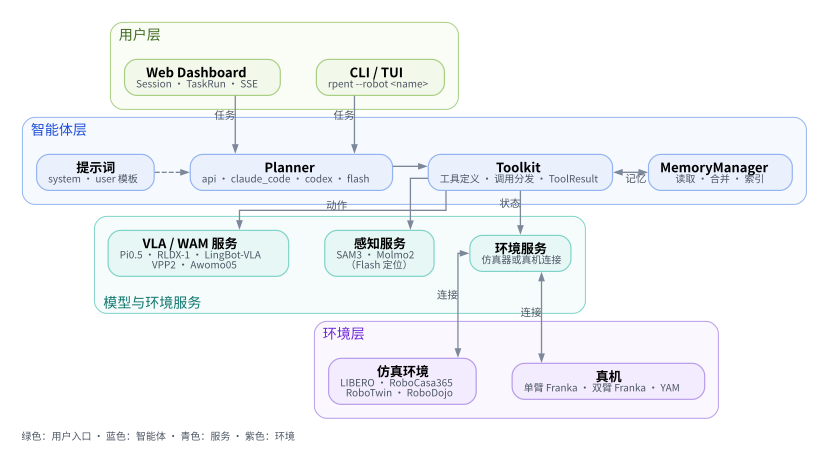

RPent 简介
============

本页介绍框架的定位、评测覆盖和已支持的平台；安装与首次运行见 :doc:`quickstart`。

RPent（Recursive Physical Agent）是一个开源框架，用于构建能够在与物理世界的递归交互中持续演进的具身智能体。RPent 不绑定单一基础模型，而是把感知、推理、记忆、执行和自我演进放进同一个智能体循环，并通过统一接口连接。更换或组合模型、规划器和机器人服务时，不需要重写整套流程。智能体在持续交互中不断反思和调整，从而获得新能力，逐步突破初始设计的能力边界。

Pent 这个名字源自五芒星（Pentagram），其五个顶点象征多模态智能融合为一个统一的具身智能体。中心的无穷符号（∞）代表感知、推理、执行和自我演进的递归循环，让智能持续向物理世界扩展。

RPent 的三条核心设计原则是服务化、标准化和可组合（service-oriented, standardized, and composable）。各种能力以可复用服务的形式部署，通过统一接口连接，并灵活组合成不同的物理智能体。这些原则使 RPent 能够超越传统机器人控制框架，成为面向物理世界的智能体基础设施，让智能在部署后继续被构建、扩展和演进。

**本文结构：** 框架与评测范围 → 排行榜 → 选择仿真环境或真实机器人。

排行榜
------

对比 LIBERO、LIBERO-PRO、RoboCasa365 Target50 和 RoboTwin C2R 上的成功率。
排名仅限图中方法及评测范围；完整结果、模型配置和来源见 :doc:`../leaderboard/index`。

.. raw:: html

   

选择平台
------------

.. list-table::
   :header-rows: 1
   :widths: 30 70

   * - 平台
     - 文档内容
   * - :doc:`LIBERO <../simulators/libero>`
     - Pi0.5、SAM3、LIBERO / LIBERO-PRO 运行与复现。
   * - :doc:`RoboCasa365 <../simulators/robocasa>`
     - RLDX-1、厨房任务和 Target50 复现。
   * - :doc:`RoboTwin <../simulators/robotwin>`
     - LingBot-VLA 或 Fast-WAM、双臂仿真任务和 C2R 复现。
   * - :doc:`RoboDojo <../simulators/robodojo>`
     - Isaac Sim 双臂 ARX-X5 操作，策略动作可选 VPP2 或 Awomo05。
   * - :doc:`单臂 Franka <../real_world_robots/franka>`
     - 硬件准备、标定、自检和运行。
   * - :doc:`双臂 Franka <../real_world_robots/dual_franka>`
     - 双节点部署、操作与人工参与的探索。
   * - :doc:`YAM <../real_world_robots/yam>`
     - 双臂部署、Pi0.5 动作、标定、探索与任务演示。
   * - :doc:`SO-101 <../real_world_robots/so101>`
     - 尚未集成，仓库中没有对应机器人适配器。

规划器可选择 ``api``、``claude_code`` 或 ``codex``；LIBERO 还提供用于执行已有计划的 :doc:`Flash Mode <../guides/flash>`。模型服务配置见 :doc:`../guides/configure_planner`。

从 :doc:`quickstart` 开始运行第一个任务。评测成绩和资源开销见 :doc:`../leaderboard/index`，研究背景见 :doc:`../resources/harnessvla`。

DreamZero 是计划中的 WAM 后端，尚未集成，暂无使用文档。
